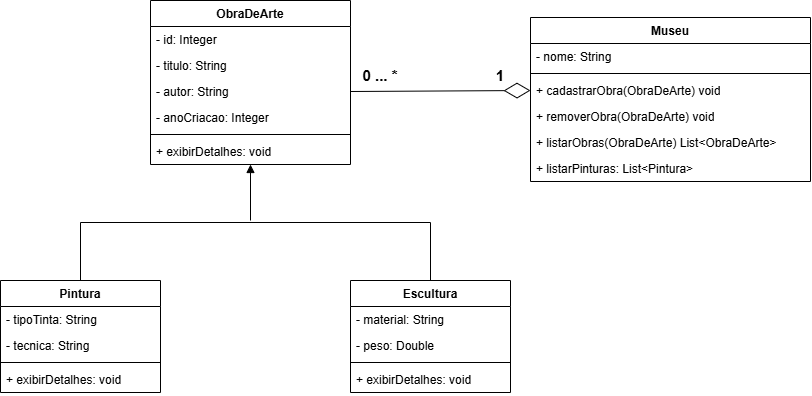

# Sistema de gerenciamento de Museu

Este é um projeto acadêmico desenvolvido em Java com o objetivo de praticar conceitos de POO (Herança e Polimorfismo) e integração com banco de dados relacional via JDBC (MySQL).

O sistema permite gerenciar o acervo de um museu, cadastrando e consultando diferentes tipos de obras de arte (Pinturas e Esculturas).

---

## Tecnologias Utilizadas

- **Linguagem:** Java
- **Banco de Dados:** MySQL
- **Conectividade:** JDBC (`DriverManager`, `PreparedStatement`, `ResultSet`)

---

## Funcionalidades e Métodos principais (`Museu.java`)

- `cadastrarObra(ObraDeArte obra)`: Insere uma nova pintura ou escultura no banco de dados MySQL, tratando a persistência dos atributos específicos de cada tipo.
- `removerObraPorId(Integer id)`: Remove uma obra de arte registrada no banco de dados através do ID.
- `listarObras()`: Consulta o banco de dados e retorna uma lista com todas as obras cadastradas no acervo (Pinturas e Esculturas).
- `listarPinturas()`: Consulta no banco de dados e retorna exclusivamente as obras filtradas do tipo Pintura.

---

## Estrutura do Projeto (Classes)

- **`ObraDeArte`**: Classe base que contém os atributos comuns (ID, título, autor e ano de criação).
- **`Pintura`**: Subclasse de `ObraDeArte` que adiciona `tipoTinta` e `tecnica`.
- **`Escultura`**: Subclasse de `ObraDeArte` que adiciona `material` e `peso`.
- **`Museu`**: Classe principal responsável pela regra de negócio e operações de CRUD no banco de dados.
- **`Conexao`**: Gerencia a conexão JDBC com o MySQL.
- **`Main`**: Interface via terminal (menu interativo) para testar o sistema.

---

Projeto desenvolvido para fins educacionais na SPTech.
